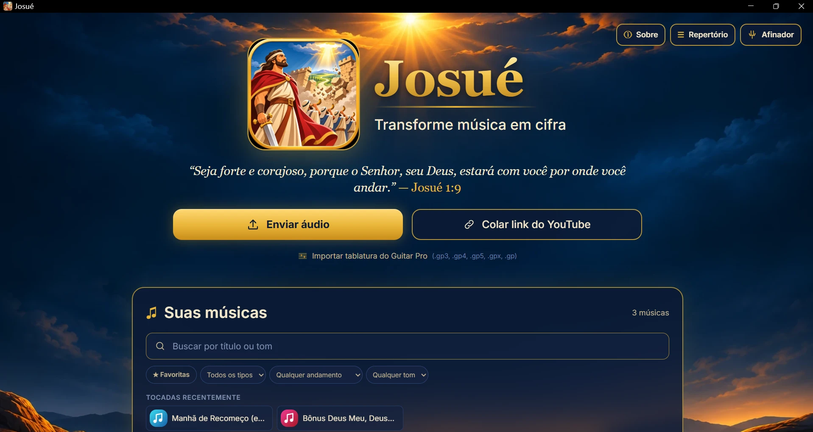

<p align="center">
  
</p>

<h1 align="center">Sistema Josué</h1>

<p align="center">
  <b>Transforme música em cifra.</b><br>
  Cifra, letra sincronizada e tablatura a partir de qualquer música — tudo no seu computador.
</p>

<p align="center">
  🌐 <a href="https://sistemajosue.free.je/"><b>sistemajosue.free.je</b></a> — site de divulgação e download
</p>

<p align="center">
  
</p>

> *“Seja forte e corajoso, porque o Senhor, seu Deus, estará com você por onde você andar.”* — Josué 1:9

---

## O que é

O **Josué** é um programa para Windows que ouve uma música e monta, sozinho, o material de estudo para quem toca e canta: a **cifra** com os acordes no lugar certo da letra, a **letra sincronizada** palavra por palavra e a **tablatura** da guitarra e do baixo. Basta enviar um arquivo de áudio ou colar um link do YouTube.

Tudo é processado **localmente**, com modelos de inteligência artificial que rodam no próprio computador — as músicas não são enviadas para nenhum servidor.

## Recursos

**Da música para a cifra**
- Envio de áudio (MP3, WAV, M4A, FLAC, OGG) ou link do YouTube
- Separação das faixas com IA: voz, guitarra, baixo, piano, bateria e outros
- Acordes reconhecidos por um modelo treinado (BTC, vocabulário amplo: 7ª, sus, inversões…), com detecção de *power chords* na guitarra
- Letra transcrita (Whisper large-v3) e alinhada palavra por palavra — ou cole a letra certa e o Josué sincroniza
- Tom, andamento (BPM), compasso e seções da música (introdução, verso, refrão, ponte…)

**Para estudar**
- Tablatura gerada da guitarra e do baixo separados, com cursor que acompanha nota por nota
- Diagramas de acordes para **violão, ukulele e teclado**
- Painel *Acorde atual* com os próximos acordes, para se preparar antes da troca
- Mudança de tom, capotraste e velocidade sem alterar a afinação; repetição A-B
- Ferramentas de estudo: revisar acordes, metrônomo, treino progressivo, escalas para solar, graus do campo harmônico e treino de troca de acordes
- Afinador pelo microfone
- Modo simples (só a letra, para quem canta)

**Para organizar e compartilhar**
- Biblioteca com busca, favoritas, filtros e backup
- Repertórios para os ensaios, com PDF único de todas as músicas
- Exportação em PDF, texto e ChordPro, ou impressão
- Compartilhamento do PDF com a banda por QR Code na rede local
- Importação de tablaturas do Guitar Pro (.gp3, .gp4, .gp5, .gpx, .gp)

## Download

Baixe pelo site **[sistemajosue.free.je](https://sistemajosue.free.je/#baixar)**. Requer Windows 10 ou 11 (64 bits).

| Versão | Tamanho | Quando usar |
|---|---|---|
| **Leve** (recomendada) | 44 MB | Baixa as bibliotecas e os modelos de IA (≈ 6 GB) durante a instalação |
| **Completa** | 5,7 GB (4 arquivos) | Já vem com tudo, para instalar sem internet |

## Como funciona

```
 áudio / link do YouTube
          │
          ▼
 ┌──────────────────────┐      ┌──────────────────────────────────────────┐
 │  App (navegador)     │ ◄──► │  Servidor local  127.0.0.1:8765          │
 │  React + Vite        │      │  FastAPI                                 │
 │  cifra, tablatura,   │      │  • Demucs (htdemucs_6s) – separa faixas  │
 │  player, biblioteca  │      │  • BTC – reconhece acordes               │
 │  (IndexedDB)         │      │  • Whisper large-v3 + wav2vec2 – letra   │
 └──────────────────────┘      │  • Basic Pitch – notas da tablatura      │
                               │  • yt-dlp – áudio do YouTube             │
                               └──────────────────────────────────────────┘
```

Sem o servidor local, o app ainda funciona no navegador com uma análise aproximada (Whisper no navegador e acordes por croma).

## Estrutura do repositório

| Pasta | Conteúdo |
|---|---|
| `app/src` | App web (React 19, TypeScript, Tailwind, alphaTab, WaveSurfer) |
| `app/server` | Servidor local em Python (FastAPI, Demucs, BTC, Whisper, Basic Pitch) |
| `app/installer` | Scripts do instalador para Windows (Inno Setup + PowerShell) |
| `site/` | Página de divulgação (HTML estático) |
| `publicar/` | Versão da página pronta para a hospedagem |
| `narracao/` | Roteiro e script de edição do vídeo de demonstração |

> Modelos de IA, instaladores, vídeos e músicas processadas não ficam no repositório (veja o `.gitignore`).

## Rodando em desenvolvimento

No PowerShell, dentro da pasta `app`:

```powershell
npm install
```

```powershell
npx vite --port 4181
```

Servidor local (em outro terminal, dentro de `app\server`, com o ambiente Python criado a partir de `app\installer\requirements-lock.txt`):

```powershell
.venv\Scripts\python.exe chords_server.py
```

Testes:

```powershell
npm test
```

## Créditos

Criado por **Flávio Lúcio Curado**.

Usa modelos e bibliotecas de código aberto, entre eles [BTC-ISMIR19](https://github.com/jayg996/BTC-ISMIR19), [Demucs](https://github.com/facebookresearch/demucs), [Whisper](https://github.com/openai/whisper) / [faster-whisper](https://github.com/SYSTRAN/faster-whisper), [Basic Pitch](https://github.com/spotify/basic-pitch), [alphaTab](https://www.alphatab.net/) e a fonte musical [Bravura](https://github.com/steinbergmedia/bravura) (SIL OFL).
